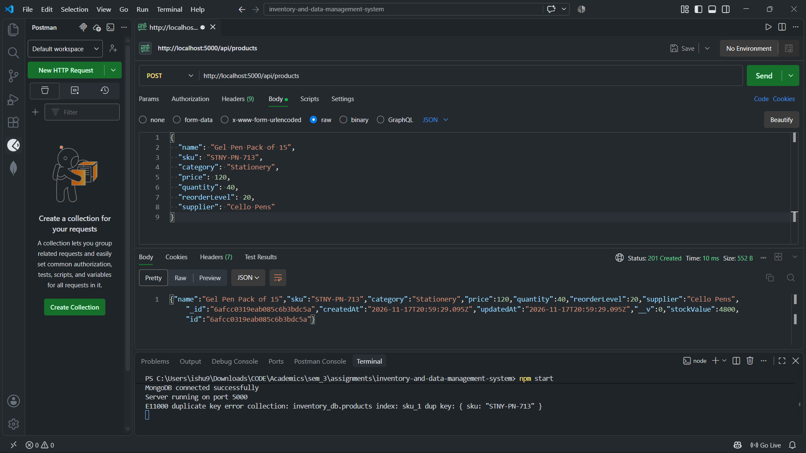
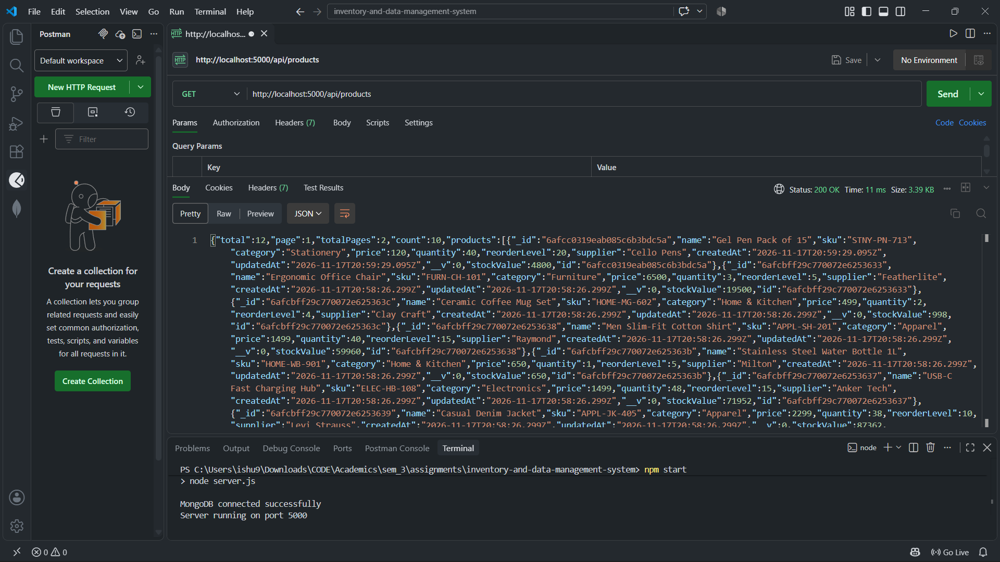
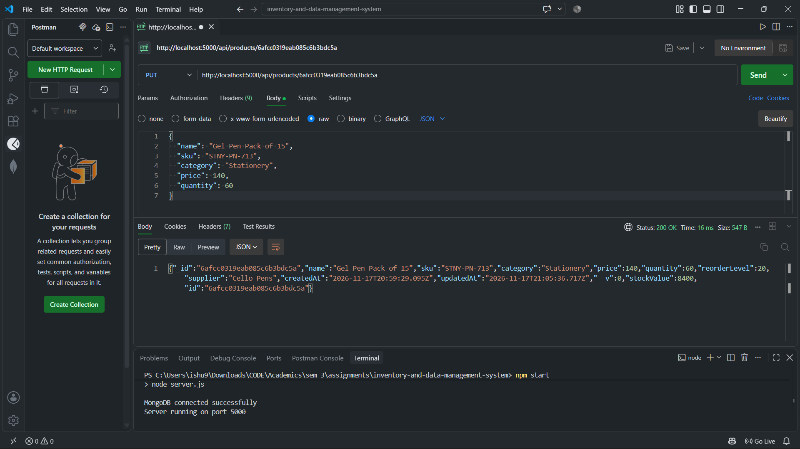
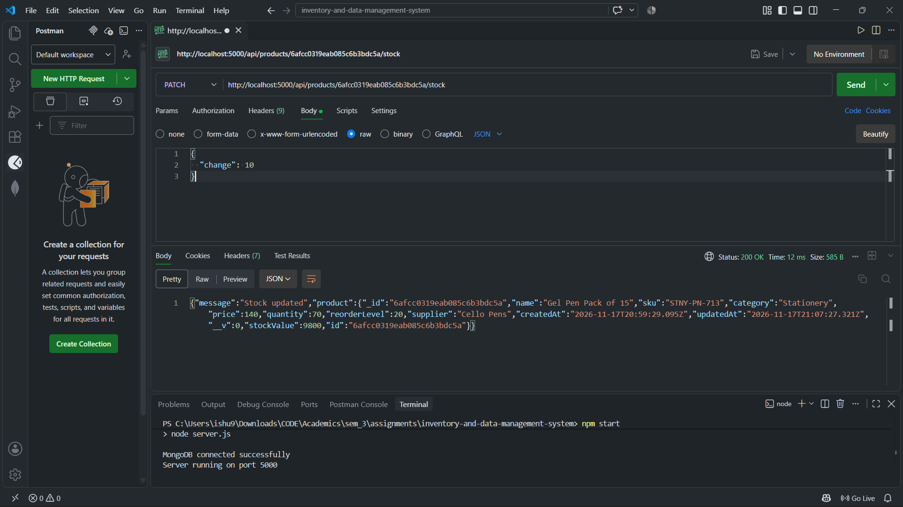
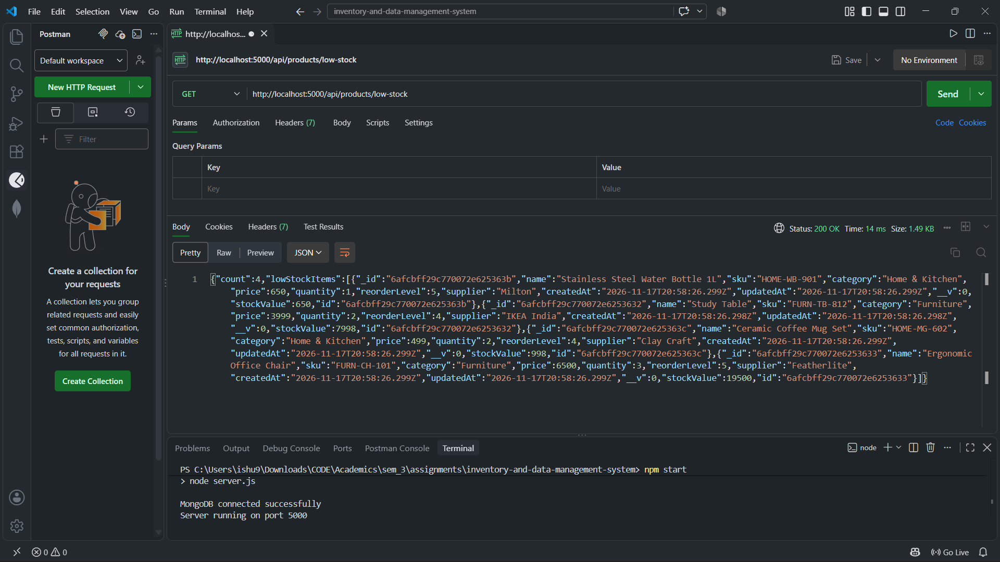
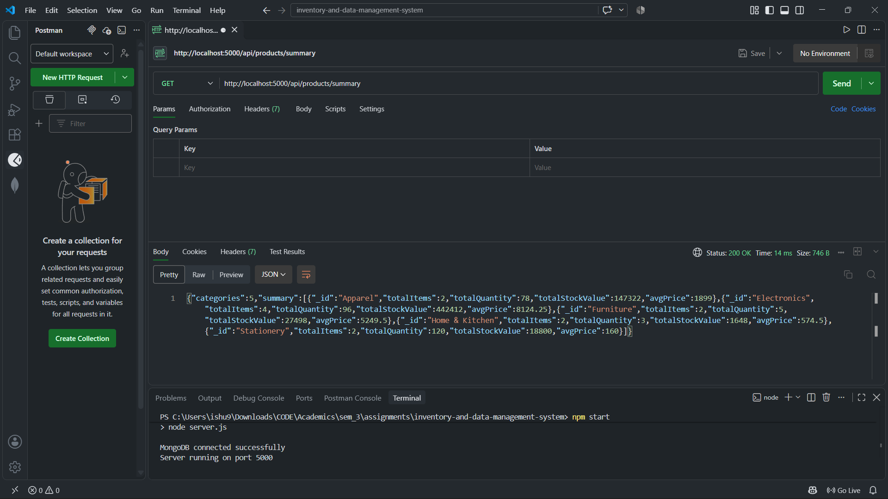
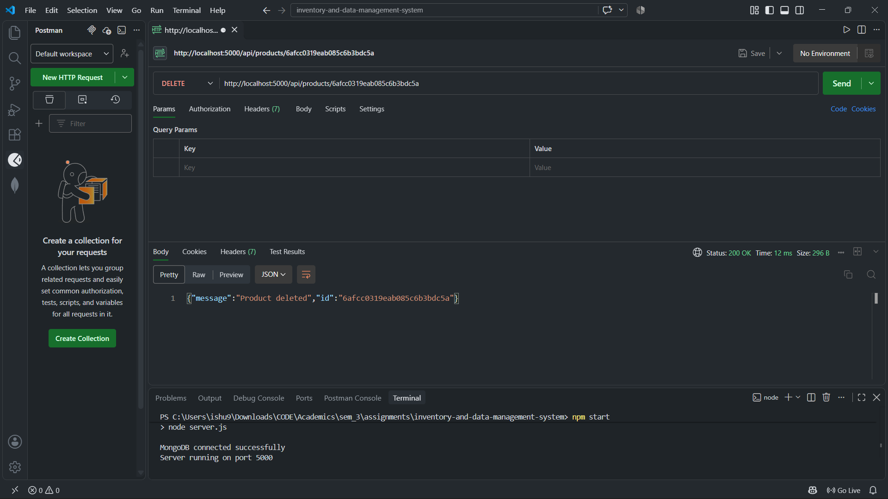

# Inventory and Data Management System

RESTful API backend for inventory management built for **Assignment 3 (Web Dev III - Unit 3)** using **Node.js, Express.js, MongoDB, Mongoose, and dotenv**.

---

## 📸 Postman Output Screenshots (Mandatory)

> **Note:** Below are the screenshots demonstrating successful execution and response validation across all required endpoints via Postman.

### 1. Create Product (`POST /api/products`)


### 2. Get All Products — Filtering, Sorting & Pagination (`GET /api/products`)


### 3. Update Product Details (`PUT /api/products/:id`)


### 4. Stock Adjustment (`PATCH /api/products/:id/stock`)


### 5. Low-Stock Alert Report (`GET /api/products/low-stock`)


### 6. Category-wise Summary Aggregation (`GET /api/products/summary`)


### 7. Delete Product (`DELETE /api/products/:id`)


---

## 🛠 Tech Stack

- **Node.js** – Server-side JavaScript runtime
- **Express.js** – Minimal web application framework
- **MongoDB** – NoSQL database
- **Mongoose** – Object Data Modeling (ODM) library
- **dotenv** – Environment configuration management

---

## 🚀 Setup & Installation

### 1. Clone the repository
```bash
git clone https://github.com/shreshthkchaudhary/inventory-and-data-management-system.git
cd inventory-and-data-management-system
```

### 2. Install dependencies
```bash
npm install
```

### 3. Configure environment variables
Create a `.env` file in the root directory (or copy from `.env.example`):
```bash
cp .env.example .env
```
Ensure your MongoDB connection string and port are set:
```env
PORT=5000
MONGO_URI=mongodb://127.0.0.1:27017/inventory_db
```

### 4. (Optional) Seed sample data
To load initial mock products into the database:
```bash
npm run seed
```

### 5. Start the server
```bash
npm start
```
The server will start at `http://localhost:5000`.

---

## 📡 API Endpoints Reference

Base URL: `http://localhost:5000/api/products`

| HTTP Method | Endpoint | Description |
|---|---|---|
| `POST` | `/` | Create a new product with field validations |
| `GET` | `/` | Retrieve products with filtering, search, sorting & pagination |
| `GET` | `/:id` | Retrieve single product details by MongoDB ID |
| `PUT` | `/:id` | Update product details |
| `PATCH` | `/:id/stock` | Increment (restock) or decrement (sale) stock safely |
| `DELETE` | `/:id` | Delete a product by ID |
| `GET` | `/low-stock` | Retrieve products with `quantity <= reorderLevel` |
| `GET` | `/summary` | Aggregation pipeline: category-wise counts, stock values & average prices |

---

## 🛡 Validations & Error Handling

- **Field Validations**: Name, SKU, category, price, quantity, and supplier are required.
- **Unique SKU**: SKU is unique and case-insensitive/uppercase normalized.
- **Stock Guard**: Decrementing stock is protected so sales cannot drive stock negative.
- **Centralized Error Handling**: Express middleware handles Mongoose validation errors, duplicate keys (`11000`), cast errors, and unexpected server issues.
